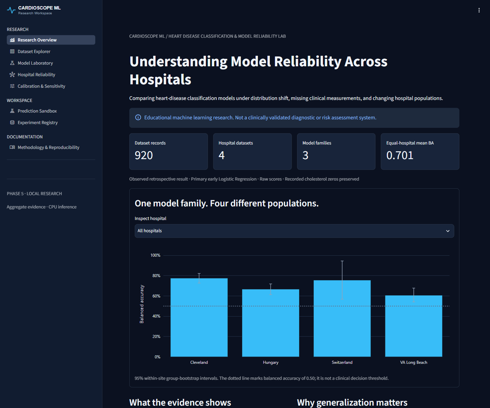

# CardioScope ML — Heart Disease Classification & Model Reliability Lab

> Educational machine learning research prototype. Not a medical device, diagnostic system, or clinically validated risk assessment tool.

**Research question.** How well do heart disease classification models generalize across different hospital populations, and how reliable are their predicted probabilities?

**Phase 4 found that both the error pattern and probability reliability changed across hospitals.** In a retrospective transfer stress test, early Logistic Regression had balanced accuracy of 0.776 in Cleveland and 0.607 at VA Long Beach. It missed 61 of 106 positives in Hungary. In Switzerland it assigned an average probability of 0.710 against 0.935 observed prevalence. All four hospitals had informed earlier pooled development. [Research findings](reports/phase4/reliability-findings.md) · [Four hospital result tables](reports/phase4/hospital-comparison.md) · [Calibration](reports/phase4/calibration-analysis.md) · [Cholesterol sensitivity](reports/phase4/cholesterol-sensitivity.md)

**Phase 3 compares three classifiers on a pooled holdout.** Logistic Regression had the highest training-only mean average precision for the primary early tier (0.8594), followed closely by Random Forest (0.8588). At the locked 0.45 threshold, Logistic Regression identified 91 of 102 recorded positives and correctly classified 55 of 83 recorded negatives. Its held-out balanced accuracy was 0.777 (95% group-bootstrap interval 0.717–0.836). [Full comparison with confusion matrices](reports/phase3/pooled-both.md) · [Training-only selection record](reports/phase3/cv-both.json)

| Model | Early CV AP | Early holdout AP | Extended CV AP | Extended holdout AP |
| --- | ---: | ---: | ---: | ---: |
| Logistic Regression | 0.8594 | 0.893 | 0.9029 | 0.921 |
| Random Forest | 0.8588 | 0.895 | 0.8979 | 0.911 |
| XGBoost | 0.8528 | 0.876 | 0.9025 | 0.907 |

CV AP averages five development-fold scores. Holdout AP summarizes one shared set of 185 records. The extended tier includes diagnostic workup and addresses a later information setting. [Dataset audit](reports/dataset-audit.md) · [Feature availability](docs/evaluation.md)

## Explore the research dashboard

Phase 5 adds eight Streamlit pages: research overview, aggregate dataset exploration, model comparisons, hospital reliability, calibration/sensitivity, a fictional prediction sandbox, an SQLAlchemy experiment registry, and reproducibility documentation. The navy/slate workspace uses interactive Plotly charts. Displayed evidence is checked against frozen report fingerprints. The dashboard runs on CPU and does not retrain during navigation.

From the repository root in PowerShell (create `.venv` with `py -3.12 -m venv .venv` if needed):

```powershell
.\.venv\Scripts\python.exe -m pip install --upgrade "pip==26.3"
.\.venv\Scripts\python.exe -m pip install -c requirements-dev.lock -e ".[dev,dashboard]"
.\.venv\Scripts\python.exe -m streamlit run app/serve.py
```

Open [the local dashboard](http://127.0.0.1:8501). Aggregate research pages work without the raw CSV. The optional fictional sandbox remains disabled until you explicitly build a local model that reproduces the recorded Phase 3 holdout prediction digest:

```powershell
.\.venv\Scripts\python.exe -m cardioscope.dashboard.sandbox
```

This command requires the exact local CSV and locked environment. No serialized model or raw dataset is committed. The sandbox's experimental score is **not a clinically validated probability of disease**. Ordinary inference stays transient. Signed-in users may explicitly save a private report for an unedited built-in example.

Sign in or create an account on the Welcome page to open Research Overview. **Keep me signed in on this device** is selected by default and lasts up to 30 days. Clear it on shared devices and use **Logout** in the sidebar to end the session. **Settings** saves chart and research defaults, **My Reports** holds your fictional profiles and private reports, and **Shared Fictional Reports** displays the result fields owners opted to share. The 102 research experiments remain in the verified catalog. [Workspace setup, privacy, and backups](docs/workspaces.md)



[Architecture, installation, database and artifact strategy](docs/dashboard.md) · [Actual browser screenshots and review](docs/dashboard-visual-review.md) · [Proposed Phase 6 checklist](docs/dashboard.md#proposed-phase-6-checklist--not-started)

[Phase 5.1 UI corrections and acceptance](docs/dashboard-phase-5-1.md)

[Phase 6 release audit and verification](docs/release-audit.md)

## Why compare hospitals?

Hungary has 106 positive outcomes among 293 records. Switzerland has 115 among 123, leaving only eight negatives. The vessel-count field (`ca`) is missing in 5 of 304 Cleveland records and 198 of 200 VA Long Beach records. A random split can reproduce these collection patterns on both sides of the split. Holding out a hospital asks whether a model transfers to a population with a different outcome frequency and different tests available.

## Reproduce the audit on Windows

From the repository root, create a local Python 3.12 environment. If Python 3.12 is available outside the Windows launcher, use that interpreter’s executable in place of `py -3.12`. An existing project `.venv` can be used directly from the second command. The constraints file records the dependency versions used for this audit on Windows.

```powershell
py -3.12 -m venv .venv
.\.venv\Scripts\python.exe -m pip install --upgrade "pip==26.3"
.\.venv\Scripts\python.exe -m pip install -c requirements-dev.lock -e ".[dev]"
New-Item -ItemType Directory -Force data/raw | Out-Null
```

Download version 6 of Redwan Sony’s combined UCI Heart Disease Data from Kaggle. Extract `heart_disease_uci.csv` into `data/raw/` without opening and resaving it. UCI’s 303-instance listing describes the Cleveland subset. The checksum below identifies the exact combined CSV used here. [Kaggle dataset](https://www.kaggle.com/datasets/redwankarimsony/heart-disease-data) · [Provenance and attribution](docs/provenance.md)

```powershell
(Get-FileHash -Algorithm SHA256 data/raw/heart_disease_uci.csv).Hash
.\.venv\Scripts\cardioscope-audit.exe --input "data/raw/heart_disease_uci.csv" --output-dir reports
```

Expected SHA-256 is `574f2fa2b43012fa25fca4fcdb36bd7c6bccdd0af4242f6c0e4c8633c5a072ae`. The CLI accepts a quoted path containing spaces. The JSON field `matches_kaggle_v6` verifies release identity independently of schema validation. Running the command twice on the same bytes reproduces the two report files. Use a separate output directory when investigating another input.

| Exit code | Meaning |
| --- | --- |
| 0 | Reports written and schema, cohort and value checks passed. Review flags can still be present. |
| 1 | Reports written with validation errors, such as unexpected sites or invalid outcomes. |
| 2 | Input, CSV structure, arguments or report I/O prevented a successful run. |

### Reproduce Phase 2

Run the package installation above once after switching branches to install scikit-learn. The protocol command executes 20 preprocessing fits. Its aggregate JSON records split membership digests, transformations and train-fitted parameters. The input remains local.

```powershell
.\.venv\Scripts\python.exe -m cardioscope.protocol --input data/raw/heart_disease_uci.csv --output reports/preprocessing-protocol.json
```

The six-field early tier assumes routine blood results are available. The 13-field extended tier adds resting ECG, exercise testing and diagnostic measurements. The default preserves cholesterol zeros. The sensitivity run masks only cholesterol zeros and fits the imputer on training rows. The two fixed designs evaluate the observed site mixture (735 train, 185 held out) and transfer to each whole hospital. [Feature schema and leakage controls](docs/evaluation.md) · [Fit record](reports/preprocessing-protocol.json) · [Source comparison commands](reports/data-quality-investigation.md)

### Reproduce the model comparison

Use the locked environment above. The CV stage trains two prespecified configurations for each of the three classifiers. All share one split and the same duplicate-grouped folds. Each fit starts with a fresh Phase 2 preprocessor inside a scikit-learn pipeline. Select by mean fold average precision and fix the threshold using development out-of-fold balanced accuracy. The evaluation stage checks the selection digest, environment, CSV and split, refits the selected pipelines, and writes aggregate JSON and Markdown.

```powershell
$csv = "data/raw/heart_disease_uci.csv"
$tier = "both"
$out = "reports/phase3"
.\.venv\Scripts\python.exe -m cardioscope.experiment --stage cv --tier $tier --input $csv --output-dir $out
.\.venv\Scripts\python.exe -m cardioscope.experiment --stage evaluate --tier $tier --input $csv --output-dir $out
.\.venv\Scripts\python.exe -m cardioscope.experiment --stage report --tier $tier --output-dir $out
```

Use `early` or `extended` for a single tier and use the same tier for all three commands. To preserve the published run timings, choose a different output directory for a replay. Check each command’s exit code. A failed stage returns 1 and records a failure in the output directory when writable. The report stage can regenerate Markdown directly from evaluation JSON. No serialized model is required.

All fits used one CPU thread, seed 2026 and as-recorded cholesterol. Logistic Regression uses L2 regularization, Random Forest averages bootstrap trees, and XGBoost fits shallow boosted trees with a binary logistic objective. The preregistered grids, tie-breaks, thresholds and uncertainty calculation are documented. [Frozen protocol](docs/model-selection.md) · [Machine-readable results](reports/phase3/pooled-both.json)

### Reproduce Phase 4

From the repository root, use Python 3.12.14 and the locked environment above. This command checks the manifest, software versions and dataset checksum, runs all four outer experiments, and regenerates the aggregate JSON, four Markdown reports and two figures. Add `--output-dir .venv/phase4-replay` for a separate replay.

```powershell
.\.venv\Scripts\python.exe -m cardioscope.transfer --input data/raw/heart_disease_uci.csv
```

Commit `7103b157534040b6e29a55d8fa00660eff6c8813` froze the protocol before site evaluation. The Phase 4 brief specified fixed Phase 3 configurations, superseding the earlier proposal for a new inner hyperparameter search. Each outer run refits preprocessing and learns its threshold and optional sigmoid from three training-site holdouts. Both zero policies and probability methods are reported. The scientific digest covers the metadata, metrics, prediction digests and interval estimates. Elapsed time is recorded separately. [Manifest](docs/phase4-protocol.json) · [Machine-readable results](reports/phase4/hospital-results.json)

The reference run and a fresh replay both produced scientific SHA-256 `c5ceaaf55c4e88916d07265962e10c5100d96d3fc4a45ff58d928acb8d0e280c`. The four Markdown reports and two PNG figures reproduced byte-for-byte. All 920 records appear once as outer evaluation cases per configuration. The duplicate policy excluded zero training rows at both the outer and inner boundaries of this release.

### Run the quality checks

```powershell
.\.venv\Scripts\python.exe -m pip install -c requirements-dev.lock -e ".[dev,dashboard]"
.\.venv\Scripts\python.exe -m pytest -q
.\.venv\Scripts\python.exe -m ruff check .
.\.venv\Scripts\python.exe -m ruff format --check .
.\.venv\Scripts\python.exe -m mypy
.\.venv\Scripts\python.exe -m pip check
```

The source CSV is required to reproduce the research reports and rebuild the optional sandbox model. The refit and fitted-artifact replay tests skip when their local inputs are absent. The rest of the suite uses the tracked aggregate reports and synthetic fixtures.

## Architecture and field roles

| Location | Responsibility |
| --- | --- |
| `src/cardioscope/data/` | CSV structure and byte checksum, field definitions, validation, derived labels and aggregate statistics |
| `src/cardioscope/cli.py`, `report.py` | Explicit input path, exit status and deterministic Markdown/JSON rendering |
| `src/cardioscope/preprocessing.py`, `splits.py`, `protocol.py` | Feature tiers, training pipelines, split safeguards and aggregate transformation records |
| `src/cardioscope/training.py`, `scoring.py`, `experiment.py`, `comparison.py` | Development-fold selection, binary metrics, pooled experiment CLI and report rendering |
| `src/cardioscope/transfer.py`, `reliability.py`, `transfer_report.py` | Nested site splits with fixed models, threshold and calibration fitting, paired bootstrap comparisons, reports and figures |
| `scripts/compare_sources.py` | Reconcile the combined CSV against UCI’s four processed files and screen for near matches |
| `data/raw/` | Local, Git-ignored source files |
| `tests/`, `reports/`, `docs/` | Synthetic regression tests, real-data audit evidence and research design |

`id` identifies a record. `dataset` identifies its hospital for grouped evaluation. The original target `num` ranges from 0 to 4. The derived binary outcome is 0 for no disease recorded and 1 for disease recorded (original classes 1–4). Both targets, the identifier and hospital metadata are excluded from the 13 candidate predictors. Predictor eligibility still depends on when a measurement would be available.

## Limitations and planned experiments

These historical records describe selected hospital populations. The holdout represents their observed mixture. Sparse diagnostic tests, unresolved zero encodings and one disputed hospital label limit interpretation. The bootstrap intervals condition on the fitted pipelines and this evaluation sample. Probabilities estimate the recorded dataset label. Calibration and transport to an unseen site remain open research questions. [Source investigation](reports/data-quality-investigation.md)

Phase 4 estimates transfer among these four historical sources. Earlier pooled development used all four hospitals. The paired comparisons are conditional on their fitted pipelines. Independent external validation would require an untouched cohort with compatible outcome definitions and documented feature timing, plus a registered model, cutoff, calibration assessment and uncertainty analysis before opening its outcomes. [Retrospective study limitations](reports/phase4/reliability-findings.md)

## Code license and redistribution

The project’s original code and documentation are licensed under [MIT](LICENSE), copyright 2026 aadarsha-hiremath. Third-party software, assets, and datasets retain their own terms. UCI lists CC BY 4.0 for its original dataset. Redistribution rights for the exact Kaggle combined CSV remain unconfirmed. Obtain the data from its source. The repository excludes raw data, source archives, fitted models, and local databases. [Dataset provenance and credits](docs/provenance.md)

**Original data citation.** Janosi, A., Steinbrunn, W., Pfisterer, M., & Detrano, R. (1989). *Heart Disease* [Dataset]. UCI Machine Learning Repository. [DOI 10.24432/C52P4X](https://doi.org/10.24432/C52P4X)
