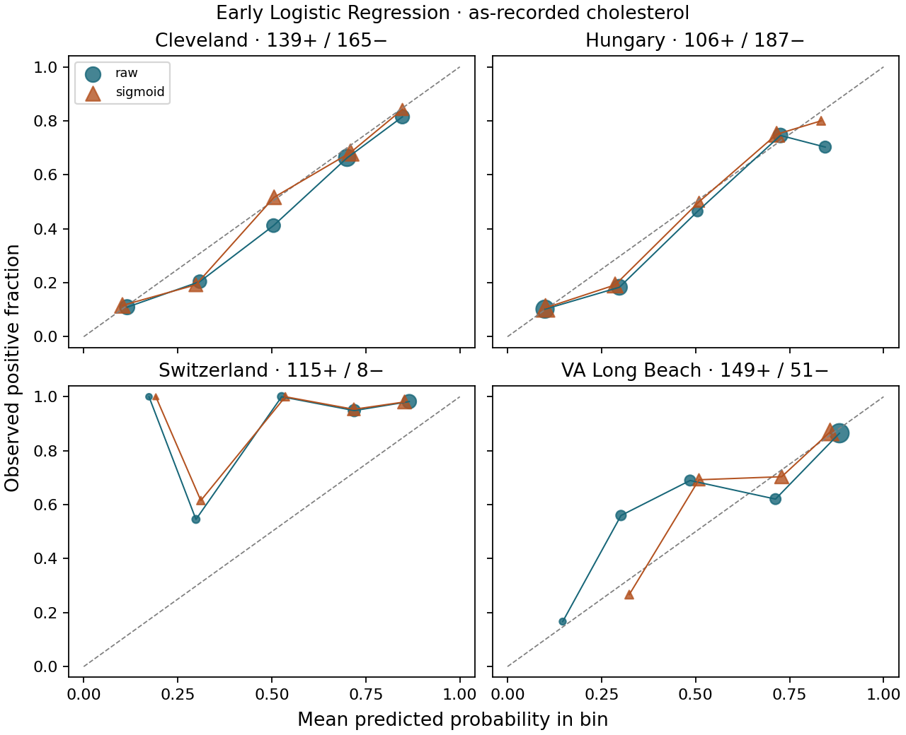

# Probability calibration under transfer

The sigmoid uses regularized logistic regression on training-site out-of-fold log odds. The transformed cutoff preserves the raw operating point. Held-out calibration intercepts and slopes are descriptive diagnostics only. An offset intercept (CITL) above zero indicates underprediction on average. A free-intercept slope below one suggests excessive spread. Ideal intercept and slope are zero and one, respectively. [Calibration definitions](https://doi.org/10.1186/s12916-019-1466-7)

The diagonal denotes agreement. Points show observed fractions against mean probabilities within five fixed probability bands. Point size reflects bin count; empty bins are omitted. Sparse bins, especially at Switzerland with eight negatives, make local estimates unstable.

## Cleveland

| Tier | Model | Brier raw → sigmoid | Log loss raw → sigmoid | CITL raw → sigmoid | Slope raw → sigmoid | Mean p raw → sigmoid | Observed |
| --- | --- | --- | --- | --- | --- | --- | --- |
| early | LR | 0.175 → 0.172 | 0.524 → 0.518 | -0.281 → -0.120 | 1.080 → 1.061 | 0.507 → 0.478 | 0.457 |
| early | RF | 0.174 → 0.169 | 0.526 → 0.513 | -0.267 → 0.064 | 1.535 → 1.382 | 0.511 → 0.445 | 0.457 |
| early | XGB | 0.169 → 0.169 | 0.511 → 0.511 | -0.271 → -0.164 | 1.351 → 1.471 | 0.508 → 0.489 | 0.457 |
| extended | LR | 0.166 → 0.161 | 0.499 → 0.487 | -0.757 → -0.678 | 1.229 → 1.183 | 0.582 → 0.567 | 0.457 |
| extended | RF | 0.175 → 0.158 | 0.527 → 0.490 | -0.597 → -0.303 | 1.934 → 1.736 | 0.579 → 0.517 | 0.457 |
| extended | XGB | 0.162 → 0.173 | 0.491 → 0.517 | -0.651 → -0.694 | 1.258 → 1.594 | 0.566 → 0.587 | 0.457 |

Early Logistic Regression bin counts and observed fractions under the primary cholesterol policy.

| Band | Method | Records | Positive | Mean p | Observed |
| --- | --- | --- | --- | --- | --- |
| 0.0–0.2 | raw | 64 | 7 | 0.115 | 0.109 |
| 0.2–0.4 | raw | 49 | 10 | 0.309 | 0.204 |
| 0.4–0.6 | raw | 51 | 21 | 0.505 | 0.412 |
| 0.6–0.8 | raw | 86 | 57 | 0.700 | 0.663 |
| 0.8–1.0 | raw | 54 | 44 | 0.847 | 0.815 |
| 0.0–0.2 | sigmoid | 69 | 8 | 0.103 | 0.116 |
| 0.2–0.4 | sigmoid | 52 | 10 | 0.298 | 0.192 |
| 0.4–0.6 | sigmoid | 60 | 31 | 0.506 | 0.517 |
| 0.6–0.8 | sigmoid | 85 | 58 | 0.709 | 0.682 |
| 0.8–1.0 | sigmoid | 38 | 32 | 0.847 | 0.842 |

## Hungary

| Tier | Model | Brier raw → sigmoid | Log loss raw → sigmoid | CITL raw → sigmoid | Slope raw → sigmoid | Mean p raw → sigmoid | Observed |
| --- | --- | --- | --- | --- | --- | --- | --- |
| early | LR | 0.158 → 0.156 | 0.488 → 0.483 | -0.286 → -0.097 | 0.966 → 1.043 | 0.407 → 0.377 | 0.362 |
| early | RF | 0.164 → 0.156 | 0.506 → 0.486 | -0.561 → -0.288 | 1.333 → 1.365 | 0.464 → 0.414 | 0.362 |
| early | XGB | 0.154 → 0.156 | 0.474 → 0.482 | -0.309 → -0.248 | 1.058 → 1.384 | 0.411 → 0.407 | 0.362 |
| extended | LR | 0.139 → 0.137 | 0.440 → 0.439 | -0.564 → -0.378 | 1.402 → 1.632 | 0.455 → 0.429 | 0.362 |
| extended | RF | 0.184 → 0.151 | 0.550 → 0.479 | -1.043 → -0.595 | 2.060 → 2.086 | 0.571 → 0.480 | 0.362 |
| extended | XGB | 0.151 → 0.159 | 0.473 → 0.498 | -0.785 → -0.602 | 1.484 → 2.244 | 0.498 → 0.485 | 0.362 |

Early Logistic Regression bin counts and observed fractions under the primary cholesterol policy.

| Band | Method | Records | Positive | Mean p | Observed |
| --- | --- | --- | --- | --- | --- |
| 0.0–0.2 | raw | 98 | 10 | 0.100 | 0.102 |
| 0.2–0.4 | raw | 71 | 13 | 0.297 | 0.183 |
| 0.4–0.6 | raw | 28 | 13 | 0.505 | 0.464 |
| 0.6–0.8 | raw | 59 | 44 | 0.726 | 0.746 |
| 0.8–1.0 | raw | 37 | 26 | 0.845 | 0.703 |
| 0.0–0.2 | sigmoid | 103 | 11 | 0.101 | 0.107 |
| 0.2–0.4 | sigmoid | 73 | 14 | 0.286 | 0.192 |
| 0.4–0.6 | sigmoid | 30 | 15 | 0.509 | 0.500 |
| 0.6–0.8 | sigmoid | 72 | 54 | 0.716 | 0.750 |
| 0.8–1.0 | sigmoid | 15 | 12 | 0.834 | 0.800 |

## Switzerland

| Tier | Model | Brier raw → sigmoid | Log loss raw → sigmoid | CITL raw → sigmoid | Slope raw → sigmoid | Mean p raw → sigmoid | Observed |
| --- | --- | --- | --- | --- | --- | --- | --- |
| early | LR | 0.124 → 0.123 | 0.410 → 0.410 | 2.120 → 2.079 | 0.836 → 0.932 | 0.710 → 0.704 | 0.935 |
| early | RF | 0.127 → 0.117 | 0.425 → 0.396 | 2.064 → 2.004 | 1.396 → 1.118 | 0.678 → 0.706 | 0.935 |
| early | XGB | 0.108 → 0.107 | 0.375 → 0.371 | 2.019 → 2.017 | 1.143 → 1.101 | 0.718 → 0.722 | 0.935 |
| extended | LR | 0.202 → 0.185 | 0.599 → 0.557 | 2.800 → 2.690 | 0.589 → 0.563 | 0.609 → 0.637 | 0.935 |
| extended | RF | 0.169 → 0.188 | 0.513 → 0.548 | 2.385 → 2.629 | 1.412 → 0.927 | 0.619 → 0.619 | 0.935 |
| extended | XGB | 0.202 → 0.195 | 0.591 → 0.575 | 2.761 → 2.711 | 0.811 → 0.816 | 0.598 → 0.606 | 0.935 |

Early Logistic Regression bin counts and observed fractions under the primary cholesterol policy.

| Band | Method | Records | Positive | Mean p | Observed |
| --- | --- | --- | --- | --- | --- |
| 0.0–0.2 | raw | 4 | 4 | 0.173 | 1.000 |
| 0.2–0.4 | raw | 11 | 6 | 0.298 | 0.545 |
| 0.4–0.6 | raw | 13 | 13 | 0.526 | 1.000 |
| 0.6–0.8 | raw | 39 | 37 | 0.719 | 0.949 |
| 0.8–1.0 | raw | 56 | 55 | 0.866 | 0.982 |
| 0.0–0.2 | sigmoid | 2 | 2 | 0.192 | 1.000 |
| 0.2–0.4 | sigmoid | 13 | 8 | 0.311 | 0.615 |
| 0.4–0.6 | sigmoid | 13 | 13 | 0.536 | 1.000 |
| 0.6–0.8 | sigmoid | 43 | 41 | 0.718 | 0.953 |
| 0.8–1.0 | sigmoid | 52 | 51 | 0.853 | 0.981 |

## VA Long Beach

| Tier | Model | Brier raw → sigmoid | Log loss raw → sigmoid | CITL raw → sigmoid | Slope raw → sigmoid | Mean p raw → sigmoid | Observed |
| --- | --- | --- | --- | --- | --- | --- | --- |
| early | LR | 0.181 → 0.171 | 0.539 → 0.518 | 0.270 → 0.180 | 0.596 → 0.854 | 0.706 → 0.715 | 0.745 |
| early | RF | 0.181 → 0.180 | 0.544 → 0.548 | 0.461 → 0.158 | 0.732 → 0.558 | 0.667 → 0.722 | 0.745 |
| early | XGB | 0.182 → 0.177 | 0.563 → 0.567 | 0.300 → -0.062 | 0.513 → 0.471 | 0.700 → 0.753 | 0.745 |
| extended | LR | 0.190 → 0.189 | 0.559 → 0.557 | 0.682 → 0.745 | 0.630 → 0.882 | 0.639 → 0.610 | 0.745 |
| extended | RF | 0.178 → 0.194 | 0.533 → 0.575 | 0.608 → 0.870 | 0.904 → 0.628 | 0.638 → 0.610 | 0.745 |
| extended | XGB | 0.214 → 0.216 | 0.637 → 0.643 | 0.900 → 0.928 | 0.433 → 0.426 | 0.619 → 0.616 | 0.745 |

Early Logistic Regression bin counts and observed fractions under the primary cholesterol policy.

| Band | Method | Records | Positive | Mean p | Observed |
| --- | --- | --- | --- | --- | --- |
| 0.0–0.2 | raw | 6 | 1 | 0.147 | 0.167 |
| 0.2–0.4 | raw | 25 | 14 | 0.302 | 0.560 |
| 0.4–0.6 | raw | 29 | 20 | 0.486 | 0.690 |
| 0.6–0.8 | raw | 29 | 18 | 0.713 | 0.621 |
| 0.8–1.0 | raw | 111 | 96 | 0.883 | 0.865 |
| 0.0–0.2 | sigmoid | 0 | 0 | undefined | undefined |
| 0.2–0.4 | sigmoid | 15 | 4 | 0.324 | 0.267 |
| 0.4–0.6 | sigmoid | 39 | 27 | 0.509 | 0.692 |
| 0.6–0.8 | sigmoid | 54 | 38 | 0.729 | 0.704 |
| 0.8–1.0 | sigmoid | 92 | 80 | 0.858 | 0.870 |

Sigmoid support requires at least 20 training OOF observations per class, varying scores and a positive fitted slope. An undefined diagnostic slope can reflect insufficient class support, constant scores or separation. The JSON includes every bin, fitted sigmoid and any unavailable method.
