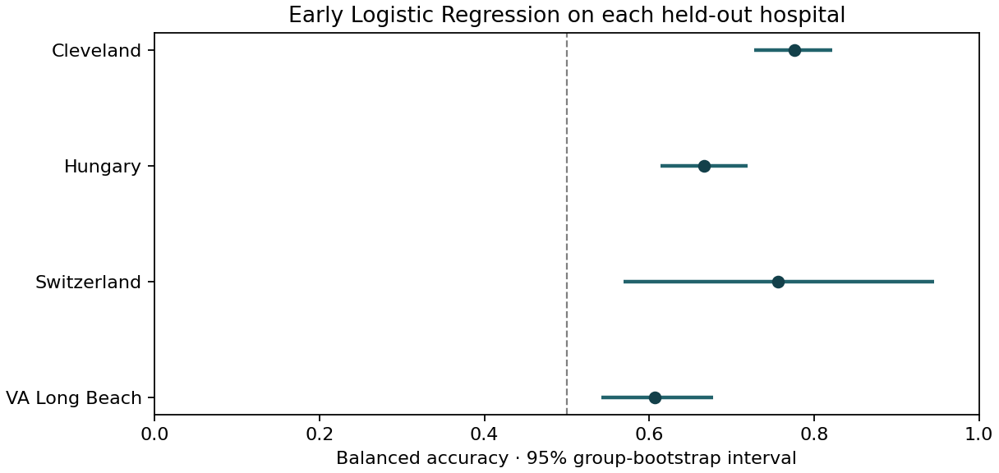

# Transfer between hospitals

Protocol freeze `7103b157534040b6e29a55d8fa00660eff6c8813`. This retrospective stress test refits six configurations at each hospital boundary. Previous pooled development used all four sources. Class 1 denotes recorded UCI outcomes 1–4. The main tables use uncalibrated scores and as-recorded cholesterol. LR = Logistic Regression, RF = Random Forest, XGB = XGBoost.

## Cleveland

Training sites: Hungary, Switzerland, VA Long Beach (616 records). Evaluation: 304 records, 139 positive and 165 negative. The AP prevalence baseline is 0.457. Training exclusions: 0.

| Tier | Model | Cut | BA | Sensitivity | Specificity | Precision | F1 | TN/FP/FN/TP | AUC | AP | AP / prevalence | Brier | Log loss |
| --- | --- | --- | --- | --- | --- | --- | --- | --- | --- | --- | --- | --- | --- |
| early | LR | 0.550 | 0.776 | 0.806 | 0.745 | 0.727 | 0.765 | 123/42/27/112 | 0.820 | 0.778 | 1.702 | 0.175 | 0.524 |
| early | RF | 0.650 | 0.743 | 0.626 | 0.861 | 0.791 | 0.699 | 142/23/52/87 | 0.833 | 0.794 | 1.736 | 0.174 | 0.526 |
| early | XGB | 0.650 | 0.757 | 0.640 | 0.873 | 0.809 | 0.715 | 144/21/50/89 | 0.836 | 0.798 | 1.744 | 0.169 | 0.511 |
| extended | LR | 0.600 | 0.789 | 0.820 | 0.758 | 0.740 | 0.778 | 125/40/25/114 | 0.871 | 0.863 | 1.888 | 0.166 | 0.499 |
| extended | RF | 0.650 | 0.768 | 0.676 | 0.861 | 0.803 | 0.734 | 142/23/45/94 | 0.870 | 0.859 | 1.878 | 0.175 | 0.527 |
| extended | XGB | 0.550 | 0.777 | 0.863 | 0.691 | 0.702 | 0.774 | 114/51/19/120 | 0.873 | 0.866 | 1.894 | 0.162 | 0.491 |

| Tier | Model | BA 95% | Sensitivity 95% | Specificity 95% | AUC 95% |
| --- | --- | --- | --- | --- | --- |
| early | LR | 0.728–0.822 | 0.737–0.868 | 0.677–0.809 | 0.768–0.867 |
| early | RF | 0.693–0.793 | 0.544–0.707 | 0.805–0.912 | 0.785–0.878 |
| early | XGB | 0.707–0.803 | 0.560–0.715 | 0.820–0.920 | 0.789–0.880 |
| extended | LR | 0.742–0.833 | 0.752–0.884 | 0.688–0.818 | 0.827–0.909 |
| extended | RF | 0.720–0.816 | 0.595–0.755 | 0.807–0.912 | 0.825–0.909 |
| extended | XGB | 0.731–0.822 | 0.803–0.917 | 0.620–0.759 | 0.829–0.912 |

## Hungary

Training sites: Cleveland, Switzerland, VA Long Beach (627 records). Evaluation: 293 records, 106 positive and 187 negative. The AP prevalence baseline is 0.362. Training exclusions: 0.

| Tier | Model | Cut | BA | Sensitivity | Specificity | Precision | F1 | TN/FP/FN/TP | AUC | AP | AP / prevalence | Brier | Log loss |
| --- | --- | --- | --- | --- | --- | --- | --- | --- | --- | --- | --- | --- | --- |
| early | LR | 0.750 | 0.667 | 0.425 | 0.909 | 0.726 | 0.536 | 170/17/61/45 | 0.826 | 0.708 | 1.956 | 0.158 | 0.488 |
| early | RF | 0.750 | 0.665 | 0.406 | 0.925 | 0.754 | 0.528 | 173/14/63/43 | 0.839 | 0.692 | 1.911 | 0.164 | 0.506 |
| early | XGB | 0.750 | 0.645 | 0.349 | 0.941 | 0.771 | 0.481 | 176/11/69/37 | 0.846 | 0.709 | 1.960 | 0.154 | 0.474 |
| extended | LR | 0.750 | 0.759 | 0.566 | 0.952 | 0.870 | 0.686 | 178/9/46/60 | 0.883 | 0.841 | 2.324 | 0.139 | 0.440 |
| extended | RF | 0.700 | 0.789 | 0.642 | 0.936 | 0.850 | 0.731 | 175/12/38/68 | 0.898 | 0.850 | 2.350 | 0.184 | 0.550 |
| extended | XGB | 0.800 | 0.744 | 0.547 | 0.941 | 0.841 | 0.663 | 176/11/48/58 | 0.886 | 0.816 | 2.254 | 0.151 | 0.473 |

| Tier | Model | BA 95% | Sensitivity 95% | Specificity 95% | AUC 95% |
| --- | --- | --- | --- | --- | --- |
| early | LR | 0.613–0.719 | 0.327–0.518 | 0.866–0.948 | 0.775–0.874 |
| early | RF | 0.613–0.714 | 0.308–0.500 | 0.884–0.961 | 0.789–0.885 |
| early | XGB | 0.596–0.697 | 0.259–0.444 | 0.904–0.973 | 0.798–0.890 |
| extended | LR | 0.708–0.808 | 0.469–0.660 | 0.916–0.980 | 0.837–0.923 |
| extended | RF | 0.737–0.835 | 0.547–0.728 | 0.898–0.969 | 0.857–0.934 |
| extended | XGB | 0.691–0.793 | 0.447–0.643 | 0.901–0.973 | 0.840–0.925 |

## Switzerland

Training sites: Cleveland, Hungary, VA Long Beach (797 records). Evaluation: 123 records, 115 positive and 8 negative. The AP prevalence baseline is 0.935. Training exclusions: 0.

| Tier | Model | Cut | BA | Sensitivity | Specificity | Precision | F1 | TN/FP/FN/TP | AUC | AP | AP / prevalence | Brier | Log loss |
| --- | --- | --- | --- | --- | --- | --- | --- | --- | --- | --- | --- | --- | --- |
| early | LR | 0.500 | 0.756 | 0.887 | 0.625 | 0.971 | 0.927 | 5/3/13/102 | 0.726 | 0.957 | 1.024 | 0.124 | 0.410 |
| early | RF | 0.450 | 0.657 | 0.939 | 0.375 | 0.956 | 0.947 | 3/5/7/108 | 0.763 | 0.968 | 1.036 | 0.127 | 0.425 |
| early | XGB | 0.550 | 0.743 | 0.861 | 0.625 | 0.971 | 0.912 | 5/3/16/99 | 0.743 | 0.966 | 1.033 | 0.108 | 0.375 |
| extended | LR | 0.450 | 0.699 | 0.774 | 0.625 | 0.967 | 0.860 | 5/3/26/89 | 0.690 | 0.960 | 1.027 | 0.202 | 0.599 |
| extended | RF | 0.500 | 0.678 | 0.730 | 0.625 | 0.966 | 0.832 | 5/3/31/84 | 0.754 | 0.973 | 1.041 | 0.169 | 0.513 |
| extended | XGB | 0.500 | 0.656 | 0.687 | 0.625 | 0.963 | 0.802 | 5/3/36/79 | 0.725 | 0.971 | 1.038 | 0.202 | 0.591 |

| Tier | Model | BA 95% | Sensitivity 95% | Specificity 95% | AUC 95% |
| --- | --- | --- | --- | --- | --- |
| early | LR | 0.568–0.945 | 0.824–0.940 | 0.250–1.000 | 0.465–0.942 |
| early | RF | 0.471–0.862 | 0.892–0.982 | 0.000–0.779 | 0.516–0.948 |
| early | XGB | 0.556–0.934 | 0.793–0.922 | 0.250–1.000 | 0.483–0.975 |
| extended | LR | 0.505–0.891 | 0.692–0.851 | 0.250–1.000 | 0.424–0.931 |
| extended | RF | 0.485–0.871 | 0.649–0.809 | 0.250–1.000 | 0.536–0.959 |
| extended | XGB | 0.464–0.852 | 0.600–0.774 | 0.250–1.000 | 0.501–0.945 |

## VA Long Beach

Training sites: Cleveland, Hungary, Switzerland (720 records). Evaluation: 200 records, 149 positive and 51 negative. The AP prevalence baseline is 0.745. Training exclusions: 0.

| Tier | Model | Cut | BA | Sensitivity | Specificity | Precision | F1 | TN/FP/FN/TP | AUC | AP | AP / prevalence | Brier | Log loss |
| --- | --- | --- | --- | --- | --- | --- | --- | --- | --- | --- | --- | --- | --- |
| early | LR | 0.400 | 0.607 | 0.899 | 0.314 | 0.793 | 0.843 | 16/35/15/134 | 0.711 | 0.865 | 1.160 | 0.181 | 0.539 |
| early | RF | 0.450 | 0.609 | 0.846 | 0.373 | 0.797 | 0.821 | 19/32/23/126 | 0.691 | 0.837 | 1.124 | 0.181 | 0.544 |
| early | XGB | 0.500 | 0.642 | 0.852 | 0.431 | 0.814 | 0.833 | 22/29/22/127 | 0.666 | 0.812 | 1.090 | 0.182 | 0.563 |
| extended | LR | 0.500 | 0.677 | 0.765 | 0.588 | 0.844 | 0.803 | 30/21/35/114 | 0.724 | 0.878 | 1.178 | 0.190 | 0.559 |
| extended | RF | 0.550 | 0.686 | 0.745 | 0.627 | 0.854 | 0.796 | 32/19/38/111 | 0.727 | 0.868 | 1.165 | 0.178 | 0.533 |
| extended | XGB | 0.350 | 0.612 | 0.852 | 0.373 | 0.799 | 0.825 | 19/32/22/127 | 0.679 | 0.833 | 1.118 | 0.214 | 0.637 |

| Tier | Model | BA 95% | Sensitivity 95% | Specificity 95% | AUC 95% |
| --- | --- | --- | --- | --- | --- |
| early | LR | 0.542–0.677 | 0.848–0.944 | 0.190–0.451 | 0.627–0.794 |
| early | RF | 0.538–0.685 | 0.782–0.903 | 0.250–0.512 | 0.600–0.781 |
| early | XGB | 0.571–0.716 | 0.792–0.908 | 0.302–0.574 | 0.569–0.766 |
| extended | LR | 0.604–0.752 | 0.691–0.831 | 0.457–0.727 | 0.637–0.803 |
| extended | RF | 0.612–0.761 | 0.673–0.815 | 0.500–0.762 | 0.641–0.807 |
| extended | XGB | 0.542–0.689 | 0.791–0.907 | 0.250–0.510 | 0.586–0.768 |

## Across-site summaries

Each pair below gives the equal-hospital mean / record-count-weighted mean of four site estimates. The latter gives Cleveland more weight than Switzerland. A weighted mean of site AUCs or APs measures within-site ranking. Cross-site patient pairs do not enter it.

| Tier | Model | BA | Sensitivity | Specificity | AUC | AP | Brier | Log loss |
| --- | --- | --- | --- | --- | --- | --- | --- | --- |
| early | LR | 0.701 / 0.702 | 0.754 / 0.716 | 0.648 / 0.688 | 0.771 / 0.786 | 0.827 / 0.798 | 0.160 / 0.164 | 0.491 / 0.501 |
| early | RF | 0.669 / 0.678 | 0.704 / 0.645 | 0.633 / 0.710 | 0.781 / 0.795 | 0.823 / 0.794 | 0.161 / 0.166 | 0.500 / 0.510 |
| early | XGB | 0.697 / 0.694 | 0.676 / 0.623 | 0.718 / 0.765 | 0.773 / 0.790 | 0.821 / 0.795 | 0.153 / 0.159 | 0.481 / 0.492 |
| extended | LR | 0.731 / 0.743 | 0.731 / 0.721 | 0.731 / 0.765 | 0.792 / 0.819 | 0.886 / 0.872 | 0.174 / 0.167 | 0.524 / 0.506 |
| extended | RF | 0.730 / 0.745 | 0.698 / 0.687 | 0.762 / 0.802 | 0.812 / 0.832 | 0.887 / 0.873 | 0.177 / 0.178 | 0.531 / 0.534 |
| extended | XGB | 0.697 / 0.715 | 0.737 / 0.737 | 0.657 / 0.693 | 0.791 / 0.815 | 0.871 / 0.857 | 0.182 / 0.175 | 0.548 / 0.530 |

Intervals use 2,000 paired within-site duplicate-group resamples. They condition on the observed site, fitted model and cutoff. Training variability and uncertainty over future hospitals are outside their scope. Empty or single-class replicates contribute only to metrics they define. JSON records the denominator for each interval. Swiss specificity moves by 0.125 per negative classification.

All 96 prespecified combinations, including both cholesterol policies and both probability methods when feasible, are described in the [machine-readable results](hospital-results.json). See [calibration](calibration-analysis.md), [sensitivity](cholesterol-sensitivity.md) and [research findings](reliability-findings.md).
